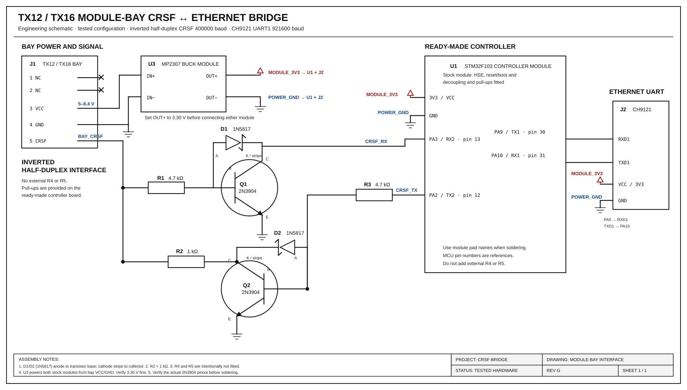
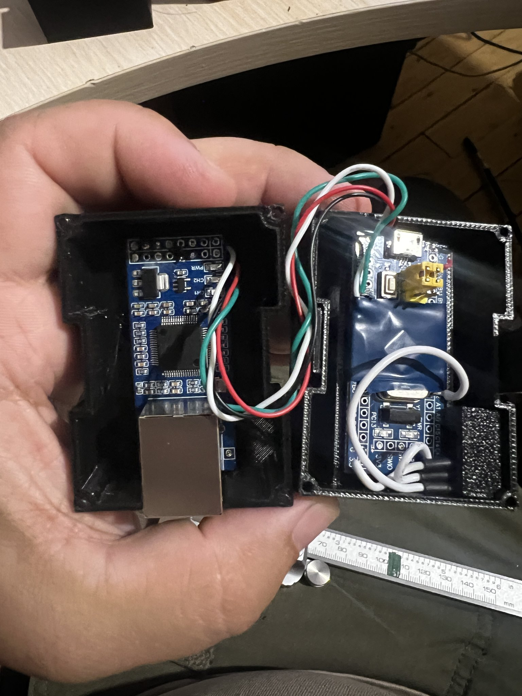
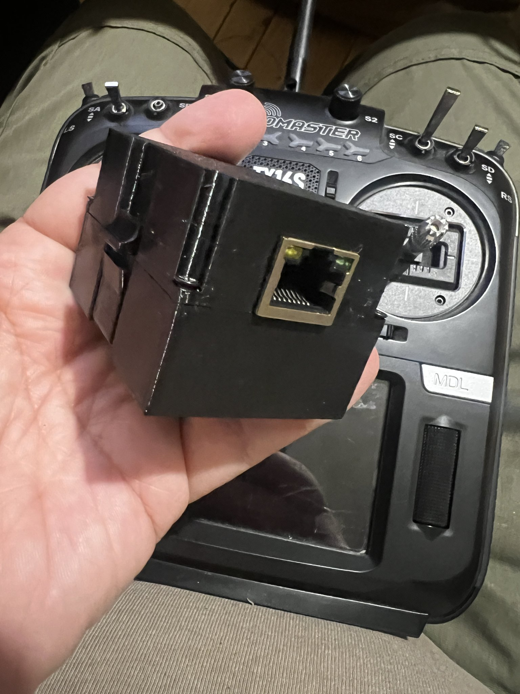
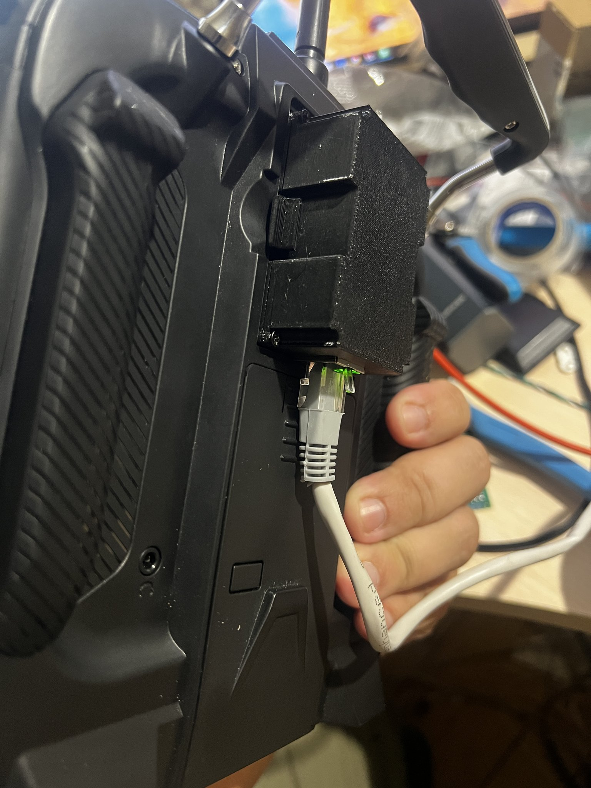
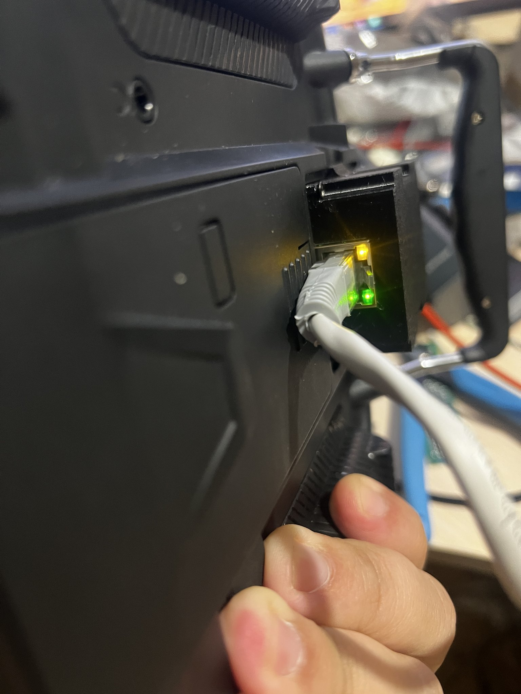

# CRSF ↔ CH9121 baud bridge (STM32F103C6T6)

**English** | [Українська](README.uk.md)

Transparent bidirectional UART bridge so Crossfire / ExpressLRS **CRSF at 400000** can ride Ethernet via **CH9121**. The CH9121 UART runs at **921600**, the fastest rate in its Default clock list (230400 / 460800 / 921600).

```
CRSF RX ──400k──► STM32#1 ──921600──► CH9121#1 ──Ethernet──► CH9121#2 ──921600──► STM32#2 ──400k──► TX12/TX16
         ◄───────           ◄────────                       ◄────────           ◄───────
```

Same firmware on both STM32 boards.

## Architecture with SineLink

```
UAV FC <-416700-> SineLink slave ~~~ radio ~~~ SineLink master <-400000-> STM32 <-921600-> CH9121 <-Ethernet-> CH9121 <-921600-> STM32 <-400000-> TX12
```

The slave on the UAV talks to the flight controller directly and is not bridged. The STM32 on the ground connects to the **master's** UART1, standing in for the radio handset.

### SineLink master UART1 settings (LinkApp)

| Setting | Value |
|---------|-------|
| Port mapping | S1 (same label as the slave's CRSF port) |
| Protocol | CRSF |
| Speed | **400000** |
| Polarity | **Not Inverted** |
| Duplex mode | **Full Duplex** |
| Rx/Tx swap | off |
| RTS/CTS flow control | **off** |
| Telemetry | Inject LINK_STATISTICS |

### Which firmware on which board

| Board | Peer on USART2 | CRSF baud | Build env |
|-------|----------------|-----------|-----------|
| Ground, SineLink master | master UART1, not inverted, full duplex | 400000 | `genericSTM32F103C6` |
| Radio side, separate TX/RX pads | radio UART, not inverted | 400000 | `genericSTM32F103C6` |
| Radio side, TX12 module bay | bay pin 5, inverted, half duplex | 400000 | `genericSTM32F103C6_bay` |
| Any peer set to 416700 | full duplex, not inverted | 416700 | `genericSTM32F103C6_rx` |

The master is a CRSF transmitter module. It sends telemetry back on the same port where it receives RC frames. If no RC frames reach it from the TX12 end of the Ethernet link, it may send nothing, so test the full chain or feed it RC frames.

### Checking the Ethernet side

```bash
# CH9121 in UDP mode with destination = this PC, port 2000
python3 tools/crsf_eth_monitor.py --udp 2000
# CH9121 in TCP CLIENT mode with destination = this PC, port 2000
python3 tools/crsf_eth_monitor.py --tcp-server 2000
```

The tool prints raw byte count, CRSF frame counts by type, and CRC failures once per second. With a live SineLink link you should see `RC_CHANNELS` and `LINK_STATISTICS` climbing and `bad_crc=0`. Raw bytes with only `bad_crc` means a baud mismatch on one of the UARTs. No bytes means the CH9121 is not configured (factory default is 9600 baud, TCP client to 192.168.1.100:1000) or not reaching this PC.

## Why 921600

On a 72 MHz STM32 the USART divisor for 921600 is `4 + 14/16` (BRR `0x4E`). Actual rate is 923077 baud, **+0.16%**, inside the CH9121 receive tolerance (2%). 400000 on USART2 is exact.

## Pinout (STM32F103C6T6)

| Signal | MCU pin | Notes |
|--------|---------|--------|
| CRSF TX (MCU → CRSF device) | **PA2** | USART2 TX |
| CRSF RX (CRSF device → MCU) | **PA3** | USART2 RX |
| CH9121 TXD → MCU | **PA10** | USART1 RX |
| MCU → CH9121 RXD | **PA9** | USART1 TX |
| GND | GND | Common ground everywhere |
| 3.3 V | 3V3 | Logic is 3.3 V |
| Heartbeat LED | **PC13** | Active-low, optional |

Cross TX↔RX between peers (MCU TX → peer RX).

### Crystal

Firmware expects an **8 MHz HSE** crystal (Blue Pill / common F103 modules) and runs the core at **72 MHz**. If your board has a different crystal, say so and the clock setup can be adjusted.

## Hardware wiring

### Board A — CRSF receiver side

```
CRSF receiver TX ────────► STM32 PA3 (USART2 RX)
CRSF receiver RX ◄──────── STM32 PA2 (USART2 TX)
CRSF GND ───────────────── STM32 GND
CRSF 3V3 / 5V (per RX) ─── power as required by the receiver

STM32 PA9  (USART1 TX) ──► CH9121 RXD1
STM32 PA10 (USART1 RX) ◄── CH9121 TXD1
STM32 GND ──────────────── CH9121 GND
STM32 3V3 ──────────────── CH9121 VCCIO / logic supply (per module)
```

### Board B — TX12 / TX16 side

Same STM32↔CH9121 wiring. The TX12/TX16 bay uses one **inverted,
half-duplex** CRSF wire at 400000 baud. Do not connect PA2 and PA3 directly to
bay pin 5 and do not simply tie PA2 to PA3. Use the verified two-transistor
circuit in [the main engineering schematic](docs/module-bay-interface-engineering.svg).

### Wiring tips for 921600

- Keep STM32↔CH9121 wires short (a few cm).
- Solid common GND.
- Prefer CH9121 **port 1** (has RTS/CTS on CH9121T if you later add flow control).

## CH9121 configuration (both modules)

Use **NetModuleConfig** (or serial CFG commands). A copy of the Windows
configuration utility is included in the repository:

- [Download NetModuleConfig.zip](docs/NetModuleConfig.zip)
- Archive contents: `NetModuleConfig.exe`
- SHA-256: `5eab3486cbf965d3b66d465fd687440166185423d4e8c40620eac59b749224ba`

`NetModuleConfig.exe` is a third-party Windows binary, not built from this
repository's source. Scan and evaluate it according to your normal security
policy before running it.

Configuration procedure:

1. Extract `NetModuleConfig.zip` on a Windows PC.
2. Connect the PC and one CH9121 module to the same Ethernet network and power
   the module. Configure one module at a time if both still have identical
   factory network settings.
3. Start `NetModuleConfig.exe`, discover/select the module, and set its network
   and UART parameters to the values below.
4. Write/save the configuration, restart the module, and read it back to
   confirm the saved values.
5. Repeat for the second CH9121 using its own unique device IP and the opposite
   module as the UDP destination.

Critical UART settings:

| Parameter | Value |
|-----------|--------|
| Serial clock mode | **Default** (the mode that offers 230400 / 460800 / 921600) |
| Baud rate | **921600** |
| Data / stop / parity | 8N1 |
| RX packet length | 64–256 (smaller = lower latency) |
| RX packet timeout | **0** (hardware timeout, best for realtime) |

Network example (adjust IPs to your LAN):

| | Module A (RX side) | Module B (radio side) |
|--|--------------------|------------------------|
| Mode | TCP Client *or* UDP | TCP Server *or* UDP |
| Device IP | e.g. 192.168.1.10 | e.g. 192.168.1.11 |
| Local port | 2000 | 2000 |
| Destination | B’s IP:2000 | A’s IP:2000 (if client) |

**UDP** is usually better for CRSF (no reconnect stall). Point each module at the other IP/port.

Set **both** CH9121 UARTs to 921600. Default clock mode is required for that rate; Classical mode does not include 921600.

## TX12 module bay, two-way

Bay pin 5 is one inverted half-duplex wire. Two NPN transistors invert it back to a normal UART and let the STM32 drive the wire only while sending. Flash **only the radio-side STM32** with the `genericSTM32F103C6_bay` firmware. The receiver-side board keeps the normal full-duplex build.

The bay build runs at **400000 baud** and forwards bytes transparently. It does
not insert delimiters or diagnostic marker bytes.

EdgeTX: Internal RF **Off**, External RF **CRSF**, baud **400000**.

### Main working schematic

The following classical engineering drawing is the source of truth for the
radio-side assembly. It supersedes the earlier hand drawing and text-only
sketches.



Use the engineering schematic above for component orientation, pin numbers,
fabrication, and inspection.

Tested assembly decisions:

- **R2 is 1 kΩ**.
- **R4 and R5 are not fitted.** The ready-made controller board supplies the
  required pull-ups; adding the external R5 caused incorrect operation on the
  tested assembly.
- U1 is a stock STM32F103 controller module. Its crystal, reset/boot network,
  supply decoupling, and board-level pull-ups are not duplicated externally.
- U3 takes bay pin 3 VCC and pin 4 GND, regulates them to 3.3 V, and powers
  both the STM32 controller module and the CH9121 module.
- CH9121 UART1 connects to PA9/PA10.
- D1 and D2 are **1N5817 Schottky diodes** used as transistor
  anti-saturation clamps.

The component naming follows the submitted drawing: **Q1 is the receive
inverter** (bay → PA3), and **Q2 is the transmit inverter** (PA2 → bay).

| Ref | Value | Connection / purpose |
|---|---:|---|
| R1 | 4.7 kΩ | Bay pin 5 → Q1 base |
| R2 | 1 kΩ | Q2 collector → bay pin 5; contention/current limiting |
| R3 | 4.7 kΩ | PA2 → Q2 base |
| R4 | DNP | No external PA3 pull-up; provided on the controller board |
| R5 | DNP | No external bay pull-up; do not fit |
| Q1 | 2N3904 | Receive inverter |
| Q2 | 2N3904 | Transmit inverter |
| D1 | 1N5817 | Q1 anti-saturation clamp |
| D2 | 1N5817 | Q2 anti-saturation clamp |
| U1 | Stock STM32F103 module | Controller with support components fitted |
| J2 | CH9121 module | Ethernet ↔ UART bridge |
| U3 | MP2307 module | Bay 5–8.4 V → regulated 3.3 V for U1 and J2 |

For both clamp diodes, connect the **anode to the transistor base** and the
**stripe/cathode to its collector**. Verify the actual transistor datasheet
before soldering: the onsemi 2N3904 TO-92 is E–B–C, but similarly marked parts
from other manufacturers may differ.

U1 is intentionally shown as a module rather than a bare MCU. Do not duplicate
its on-board crystal, reset/boot parts, decoupling, or pull-ups. The PA2/PA3
inverter and PA9/PA10 CH9121 connections remain exactly as shown.

Design references: [STM32F103C6 datasheet](https://www.st.com/resource/en/datasheet/stm32f103c6.pdf),
[STM32F10xxx hardware guidelines](https://www.st.com/resource/en/application_note/an2586-stm32-hardware-design-guidelines-stmicroelectronics.pdf),
[2N3904 datasheet](https://www.onsemi.com/pdf/datasheet/2n3904-d.pdf),
[1N5817 datasheet](https://www.onsemi.com/pdf/datasheet/1n5817-d.pdf), and
[MP2307 datasheet](https://www.monolithicpower.com/en/documentview/productdocument/index/version/2/document_type/Datasheet/lang/en/sku/MP2307/document_id/503/).

### Printable TX12/TX16 bay enclosure

The `docs` directory includes the printable enclosure parts as STL files and
their editable SolidWorks sources. The completed assembly holds the CH9121,
STM32 module, power converter, bay contacts, and an externally accessible RJ45
connector.

| Part | Ready to print | Editable SolidWorks source |
|---|---|---|
| Main module enclosure | [tx12-16_module.STL](docs/tx12-16_module.STL) | [tx12-16_module.SLDPRT](docs/tx12-16_module.SLDPRT) |
| Ethernet / RJ45 section | [tx12-16_ethernet.STL](docs/tx12-16_ethernet.STL) | [tx12-16_ethernet.SLDPRT](docs/tx12-16_ethernet.SLDPRT) |
| Bay contact holder | [tx12-16-contact_holder.STL](docs/tx12-16-contact_holder.STL) | [tx12-16-contact_holder.SLDPRT](docs/tx12-16-contact_holder.SLDPRT) |

Check the part scale and printer tolerances before the final print. The
repository does not prescribe a material, layer height, support strategy, or
other slicer settings.

| Internal assembly | Closed enclosure |
|---|---|
|  |  |
| Installed side view | Installed Ethernet connection |
|  |  |

```bash
pio run -e genericSTM32F103C6_bay
~/.platformio/penv/bin/python tools/flash_via_esp32.py .pio/build/genericSTM32F103C6_bay/firmware.bin
```

Disconnect the CH9121 from PA9/PA10 before that upload, then reconnect it. The level-shifter module is for separate 5 V TX/RX pads. It does not replace this circuit.

## Program the STM32 with the YD-ESP32-23

The YD-ESP32-23 (ESP32-S3) is the programmer. Its USB-UART port is `/dev/ttyACM0`. Unplug the CH9121 from PA9/PA10 while programming. Put a **10 kΩ resistor from STM32 BOOT0 to GND** so BOOT0 stays low while the ESP32 is resetting.

| YD-ESP32-23 | STM32F103C6T6 |
|-------------|----------------|
| **3V3** | 3V3 |
| **G** | GND |
| **17** | **PA10** (pin 31, USART1 RX) |
| **18** | **PA9** (pin 30, USART1 TX) |
| **4** | **BOOT0** (pin 44) |
| **5** | **NRST** (pin 7) |

BOOT1 / PB2 stays at GND.

Flash the programmer onto the ESP32 once (this replaces whatever firmware is on that board):

```bash
cd ~/Projects/crsf-bridge/programmer
pio run -t upload
```

Build the bridge, then send it through the ESP32:

```bash
cd ~/Projects/crsf-bridge
pio run -e genericSTM32F103C6
~/.platformio/penv/bin/python tools/flash_via_esp32.py .pio/build/genericSTM32F103C6/firmware.bin
```

Check the wiring without erasing the STM32:

```bash
~/.platformio/penv/bin/python tools/flash_via_esp32.py --id
```

`ID 0412` is the STM32F103C6. After `DONE`, the ESP32 releases BOOT0 and the bridge firmware runs. Reconnect the CH9121 to PA9/PA10 only after disconnecting GPIO17 and GPIO18.

## Build & flash with ST-Link

```bash
cd ~/Projects/crsf-bridge
pio run -e genericSTM32F103C6
pio run -e genericSTM32F103C6 -t upload
```

ST-Link on SWDIO / SWCLK / GND / 3V3. For a Blue Pill / C8 board use `-e bluepill_f103c8`.

### Upload over serial (no ST-Link)

The ROM bootloader is on **USART1**, the same pins as the CH9121. Unplug the CH9121 from PA9/PA10 before flashing.

| USB-UART (3.3 V) | STM32 |
|------------------|--------|
| TX | **PA10** (USART1 RX) |
| RX | **PA9** (USART1 TX) |
| GND | GND |

1. **BOOT0** (pin 44) to 3.3 V. **BOOT1 / PB2** (pin 20) stays at GND.
2. Press reset, or power-cycle.
3. Upload:

```bash
pio run -e genericSTM32F103C6_serial -t upload
```

`upload_port` in `platformio.ini` is `/dev/ttyUSB0`. Change it if the adapter enumerates as another device.

4. **BOOT0** back to GND, reconnect the CH9121, press reset. The bridge firmware then runs from flash.

## Baud math (sanity check)

At 72 MHz:

- USART1 (APB2 = 72 MHz), 921600 → BRR `0x4E` → 923077 baud (+0.16%)
- USART2 (APB1 = 36 MHz), 400000 → `USARTDIV = 5.625` → exact  

## What this does / does not do

- **Does:** byte-transparent bridge, both directions, interrupt + ring buffers  
- **Does not:** parse CRSF, change frame timing, or configure the CH9121 for you  

If packets look corrupted, verify **921600** on **both** CH9121s and that radio/RX stay at 400000.

## License and attribution

Copyright © 2026 **Lex Vyshnevskyy**. This project is open-source software
under the [MIT License](LICENSE). You may use, copy, and modify it, but copies
or substantial portions must retain the copyright and license notice.

The canonical project repository is
[lexvyshnevskyy/crsf-bridge](https://github.com/lexvyshnevskyy/crsf-bridge).
Source-file headers include this attribution and repository address so forks
can retain the project's origin.

An open-source license cannot exclude people solely by country or nationality.
The author's position concerning use by Russian state, military, occupation,
intelligence, and defense organizations is documented separately in the
[ethical-use statement](ETHICAL_USE.md). That statement is a request and
support policy, not an additional license restriction.
