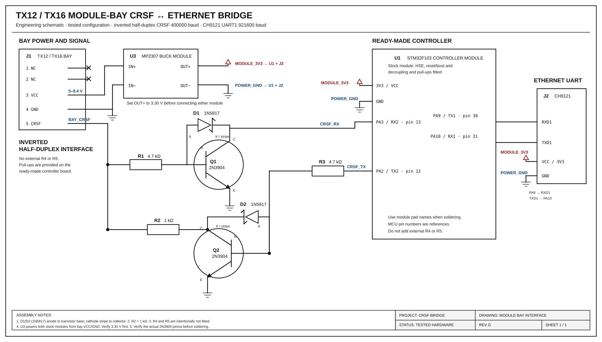

# Міст CRSF ↔ CH9121 із перетворенням швидкості (STM32F103C6T6)

[English](README.md) | **Українська**

Прозорий двонапрямний UART-міст, який передає **CRSF на 400000 бод** через Ethernet за допомогою **CH9121**. UART модуля CH9121 працює на **921600 бод** — це найбільша швидкість у переліку режиму Default (230400 / 460800 / 921600).

```text
CRSF RX ──400k──► STM32#1 ──921600──► CH9121#1 ──Ethernet──► CH9121#2 ──921600──► STM32#2 ──400k──► TX12/TX16
         ◄───────           ◄────────                       ◄────────           ◄───────
```

На обох платах STM32 використовується однакова прошивка, окрім спеціальної збірки для інвертованої напівдуплексної шини module bay.

## Архітектура із SineLink

```text
UAV FC <-416700-> SineLink slave ~~~ radio ~~~ SineLink master <-400000-> STM32 <-921600-> CH9121 <-Ethernet-> CH9121 <-921600-> STM32 <-400000-> TX12
```

Ведений SineLink на БПЛА з'єднується з польотним контролером безпосередньо й не проходить через міст. Наземний STM32 підключається до UART1 **головного** SineLink і замінює для нього пульт.

### Налаштування UART1 головного SineLink у LinkApp

| Параметр | Значення |
|---|---|
| Port mapping | S1 — та сама позначка, що й CRSF-порт веденого модуля |
| Protocol | CRSF |
| Speed | **400000** |
| Polarity | **Not Inverted** |
| Duplex mode | **Full Duplex** |
| Rx/Tx swap | off |
| RTS/CTS flow control | **off** |
| Telemetry | Inject LINK_STATISTICS |

### Яку прошивку використовувати

| Плата | Пристрій на USART2 | Швидкість CRSF | Середовище збірки |
|---|---|---:|---|
| Наземна, SineLink master | UART1 головного модуля, без інверсії, full duplex | 400000 | `genericSTM32F103C6` |
| Біля пульта, окремі TX/RX | UART пульта, без інверсії | 400000 | `genericSTM32F103C6` |
| Біля пульта, module bay TX12 | контакт 5 bay, інверсія, half duplex | 400000 | `genericSTM32F103C6_bay` |
| Будь-який пристрій на 416700 | full duplex, без інверсії | 416700 | `genericSTM32F103C6_rx` |

Головний SineLink є CRSF-модулем передавача. Він повертає телеметрію через той самий порт, яким отримує RC-кадри. Якщо RC-кадри з боку TX12 не доходять через Ethernet, модуль може нічого не передавати. Перевіряйте весь тракт або подавайте тестові RC-кадри.

### Перевірка Ethernet

```bash
# CH9121 у режимі UDP: адреса призначення — цей ПК, порт 2000
python3 tools/crsf_eth_monitor.py --udp 2000
# CH9121 у режимі TCP CLIENT: адреса призначення — цей ПК, порт 2000
python3 tools/crsf_eth_monitor.py --tcp-server 2000
```

Інструмент щосекунди показує кількість сирих байтів, кадри CRSF за типами та помилки CRC. Під час роботи SineLink лічильники `RC_CHANNELS` і `LINK_STATISTICS` мають зростати, а `bad_crc` має дорівнювати нулю. Байти лише з `bad_crc` зазвичай означають неправильну швидкість одного з UART. Відсутність байтів означає, що CH9121 не налаштований або не має мережевого зв'язку з ПК.

## Чому 921600 бод

Для STM32 на 72 МГц дільник USART для 921600 дорівнює `4 + 14/16` (BRR `0x4E`). Фактична швидкість — 923077 бод, похибка **+0,16%**, що вкладається у 2% допуску приймача CH9121. Швидкість 400000 на USART2 є точною.

## Контакти STM32F103C6T6

| Сигнал | Контакт MCU | Примітка |
|---|---|---|
| CRSF TX, MCU → CRSF | **PA2** | USART2 TX |
| CRSF RX, CRSF → MCU | **PA3** | USART2 RX |
| CH9121 TXD → MCU | **PA10** | USART1 RX |
| MCU → CH9121 RXD | **PA9** | USART1 TX |
| Земля | GND | Спільна земля для всіх модулів |
| Живлення логіки | 3V3 | Рівні сигналів 3,3 В |
| Індикатор | **PC13** | Активний низький рівень, необов'язково |

Між пристроями перехрещуйте TX і RX: TX одного пристрою підключається до RX іншого.

### Кварц

Прошивка розрахована на кварц **8 МГц HSE** і частоту ядра **72 МГц**. Це типовий варіант Blue Pill та інших модулів F103. Для іншого кварцу треба змінити налаштування тактування.

## З'єднання обладнання

### Плата A — сторона звичайного CRSF-приймача

```text
CRSF receiver TX ────────► STM32 PA3 (USART2 RX)
CRSF receiver RX ◄──────── STM32 PA2 (USART2 TX)
CRSF GND ───────────────── STM32 GND
CRSF 3V3 / 5V ──────────── живлення відповідно до вимог приймача

STM32 PA9  (USART1 TX) ──► CH9121 RXD1
STM32 PA10 (USART1 RX) ◄── CH9121 TXD1
STM32 GND ──────────────── CH9121 GND
STM32 3V3 ──────────────── CH9121 VCCIO / logic supply
```

### Плата B — сторона TX12 / TX16

З'єднання STM32↔CH9121 таке саме. Module bay TX12/TX16 використовує один **інвертований напівдуплексний** провід CRSF на 400000 бод. Не підключайте PA2 та PA3 безпосередньо до контакту 5 і не з'єднуйте PA2 з PA3. Використовуйте перевірену двотранзисторну схему з [головного інженерного креслення](docs/module-bay-interface-engineering.svg).

Для 921600 бод дроти між STM32 і CH9121 мають бути короткими, бажано кілька сантиметрів. Забезпечте надійну спільну землю. Рекомендовано використовувати порт 1 CH9121.

## Налаштування обох CH9121

Використовуйте **NetModuleConfig** або послідовні CFG-команди.

| Параметр | Значення |
|---|---|
| Serial clock mode | **Default** |
| Baud rate | **921600** |
| Data / stop / parity | 8N1 |
| RX packet length | 64–256; менше значення знижує затримку |
| RX packet timeout | **0** — апаратний тайм-аут |

Приклад мережі:

| | Модуль A, сторона RX | Модуль B, сторона пульта |
|---|---|---|
| Mode | TCP Client або UDP | TCP Server або UDP |
| Device IP | наприклад 192.168.1.10 | наприклад 192.168.1.11 |
| Local port | 2000 | 2000 |
| Destination | IP модуля B:2000 | IP модуля A:2000 для client/UDP |

Для CRSF зазвичай краще підходить **UDP**, бо немає пауз на повторне TCP-з'єднання. Вкажіть на кожному модулі IP та порт другого модуля. На обох CH9121 установіть 921600 і режим тактування Default; режим Classical не має швидкості 921600.

## Двонапрямний зв'язок із module bay TX12

Контакт 5 bay — один інвертований напівдуплексний провід. Два NPN-транзистори перетворюють його на звичайний UART і дають STM32 керувати лінією лише під час передавання. Прошивайте збіркою `genericSTM32F103C6_bay` **лише STM32 біля пульта**. На іншому боці залишається звичайна full-duplex збірка.

Bay-збірка працює на **400000 бод** і прозоро пересилає байти. Вона не додає розділювачів або діагностичних байтів.

EdgeTX: Internal RF **Off**, External RF **CRSF**, baud **400000**.

### Головна робоча схема

Це класичне інженерне креслення є основним джерелом для складання сторони пульта:



Для спрощеного огляду потоку сигналів дивіться [кольорову схему підключення](docs/module-bay-interface.svg). Для орієнтації компонентів, номерів контактів, виготовлення та перевірки використовуйте інженерне креслення.

Перевірені рішення:

- **R2 = 1 кОм**.
- **R4 та R5 не встановлюються.** Потрібні підтягувальні резистори вже є на готовій платі контролера. Зовнішній R5 порушував роботу перевіреної збірки.
- U1 — готовий модуль STM32F103. Його кварц, BOOT/reset, розв'язувальні конденсатори та підтягувальні резистори не дублюються.
- U3 отримує VCC з контакту 3 bay і GND з контакту 4, формує 3,3 В та живить STM32 і CH9121.
- UART1 CH9121 підключається до PA9/PA10.
- D1 і D2 — діоди Шотткі **1N5817**, що запобігають насиченню транзисторів.

Позначення відповідають робочій схемі: **Q1 — приймальний інвертор** (bay → PA3), **Q2 — передавальний інвертор** (PA2 → bay).

| Позначення | Значення | Підключення / призначення |
|---|---:|---|
| R1 | 4,7 кОм | Bay pin 5 → база Q1 |
| R2 | 1 кОм | Колектор Q2 → bay pin 5; обмеження струму при конфлікті |
| R3 | 4,7 кОм | PA2 → база Q2 |
| R4 | DNP | Зовнішній pull-up PA3 не потрібен |
| R5 | DNP | Зовнішній pull-up bay не встановлювати |
| Q1 | 2N3904 | Приймальний інвертор |
| Q2 | 2N3904 | Передавальний інвертор |
| D1 | 1N5817 | Антинасичувальний діод Q1 |
| D2 | 1N5817 | Антинасичувальний діод Q2 |
| U1 | Готовий модуль STM32F103 | Контролер з установленими допоміжними компонентами |
| J2 | Модуль CH9121 | Міст Ethernet ↔ UART |
| U3 | Модуль MP2307 | Bay 5–8,4 В → стабілізовані 3,3 В для U1 і J2 |

Для D1 і D2 підключіть **анод до бази**, а **катод зі смугою — до колектора** відповідного транзистора. Перед паянням перевірте datasheet саме вашого виробника: onsemi 2N3904 у TO-92 має порядок E–B–C, але аналоги можуть відрізнятися.

Довідкові документи: [STM32F103C6](https://www.st.com/resource/en/datasheet/stm32f103c6.pdf), [рекомендації STM32F10xxx](https://www.st.com/resource/en/application_note/an2586-stm32-hardware-design-guidelines-stmicroelectronics.pdf), [2N3904](https://www.onsemi.com/pdf/datasheet/2n3904-d.pdf), [1N5817](https://www.onsemi.com/pdf/datasheet/1n5817-d.pdf), [MP2307](https://www.monolithicpower.com/en/documentview/productdocument/index/version/2/document_type/Datasheet/lang/en/sku/MP2307/document_id/503/).

## Збірка bay-прошивки

```bash
pio run -e genericSTM32F103C6_bay
~/.platformio/penv/bin/python tools/flash_via_esp32.py .pio/build/genericSTM32F103C6_bay/firmware.bin
```

Перед завантаженням від'єднайте CH9121 від PA9/PA10, після завершення підключіть знову.

## Програмування STM32 через YD-ESP32-23

YD-ESP32-23 на ESP32-S3 працює як програматор. Його USB-UART — `/dev/ttyACM0`. Під час програмування від'єднайте CH9121 від PA9/PA10. Установіть резистор **10 кОм між STM32 BOOT0 і GND**, щоб BOOT0 залишався в низькому стані під час скидання ESP32.

| YD-ESP32-23 | STM32F103C6T6 |
|---|---|
| **3V3** | 3V3 |
| **G** | GND |
| **17** | **PA10**, pin 31, USART1 RX |
| **18** | **PA9**, pin 30, USART1 TX |
| **4** | **BOOT0**, pin 44 |
| **5** | **NRST**, pin 7 |

BOOT1 / PB2 залишається на GND.

Один раз запишіть прошивку програматора в ESP32:

```bash
cd ~/Projects/crsf-bridge/programmer
pio run -t upload
```

Зберіть міст і передайте його прошивку через ESP32:

```bash
cd ~/Projects/crsf-bridge
pio run -e genericSTM32F103C6
~/.platformio/penv/bin/python tools/flash_via_esp32.py .pio/build/genericSTM32F103C6/firmware.bin
```

Перевірка підключення без стирання STM32:

```bash
~/.platformio/penv/bin/python tools/flash_via_esp32.py --id
```

`ID 0412` відповідає STM32F103C6. Після `DONE` ESP32 відпускає BOOT0, і запускається прошивка моста. Підключайте CH9121 до PA9/PA10 лише після від'єднання GPIO17 та GPIO18.

## Збірка та прошивання через ST-Link

```bash
cd ~/Projects/crsf-bridge
pio run -e genericSTM32F103C6
pio run -e genericSTM32F103C6 -t upload
```

Підключіть ST-Link до SWDIO, SWCLK, GND і 3V3. Для плати Blue Pill / C8 використовуйте `-e bluepill_f103c8`.

### Завантаження через UART без ST-Link

ROM bootloader працює на **USART1**, тобто на тих самих контактах, що й CH9121. Перед прошиванням від'єднайте CH9121 від PA9/PA10.

| USB-UART, 3,3 В | STM32 |
|---|---|
| TX | **PA10**, USART1 RX |
| RX | **PA9**, USART1 TX |
| GND | GND |

1. Підключіть **BOOT0** до 3,3 В. **BOOT1 / PB2** залишається на GND.
2. Натисніть reset або перезапустіть живлення.
3. Виконайте:

```bash
pio run -e genericSTM32F103C6_serial -t upload
```

У `platformio.ini` задано `upload_port = /dev/ttyUSB0`. Змініть його, якщо адаптер має іншу назву.

4. Поверніть **BOOT0** на GND, підключіть CH9121 і натисніть reset.

## Перевірка розрахунку швидкостей

На частоті 72 МГц:

- USART1, APB2 = 72 МГц: 921600 → BRR `0x4E` → 923077 бод, +0,16%;
- USART2, APB1 = 36 МГц: 400000 → `USARTDIV = 5.625` → точне значення.

## Що робить і чого не робить прошивка

- **Робить:** прозоро пересилає байти в обох напрямках через переривання та кільцеві буфери.
- **Не робить:** не розбирає CRSF, не змінює часові параметри кадрів і не налаштовує CH9121.

Якщо пакети пошкоджені, перевірте **921600** на обох CH9121 і **400000** на стороні пульта/CRSF.
